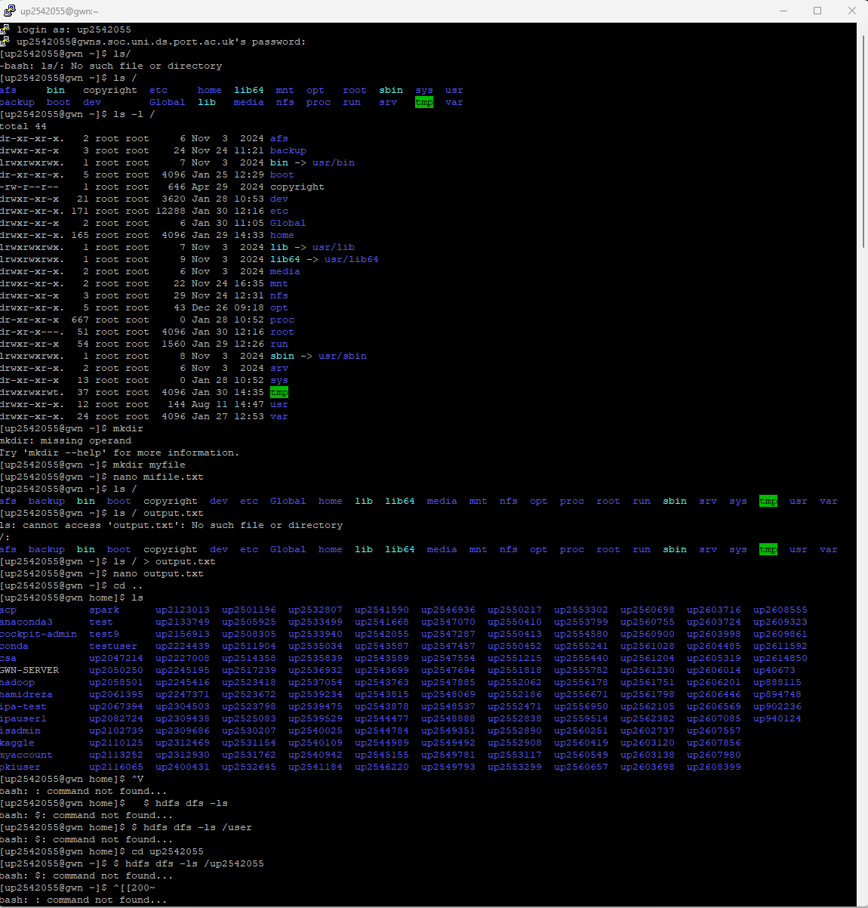
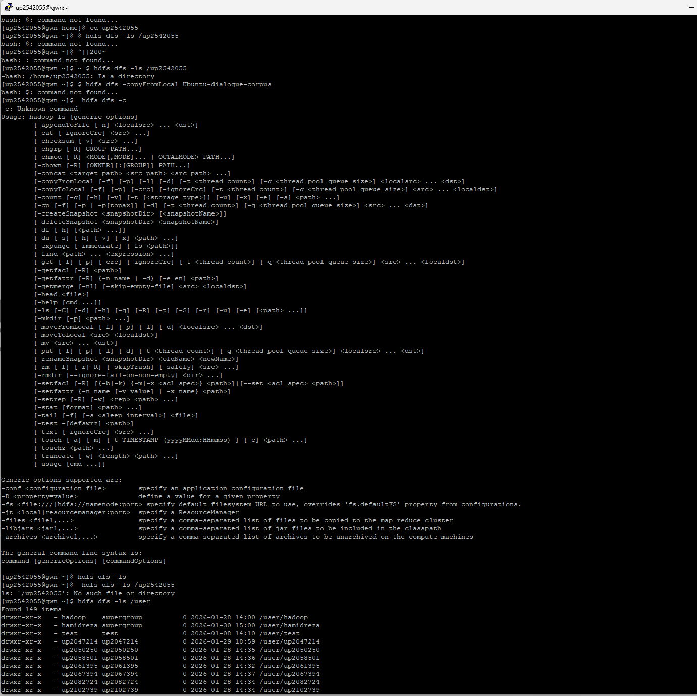
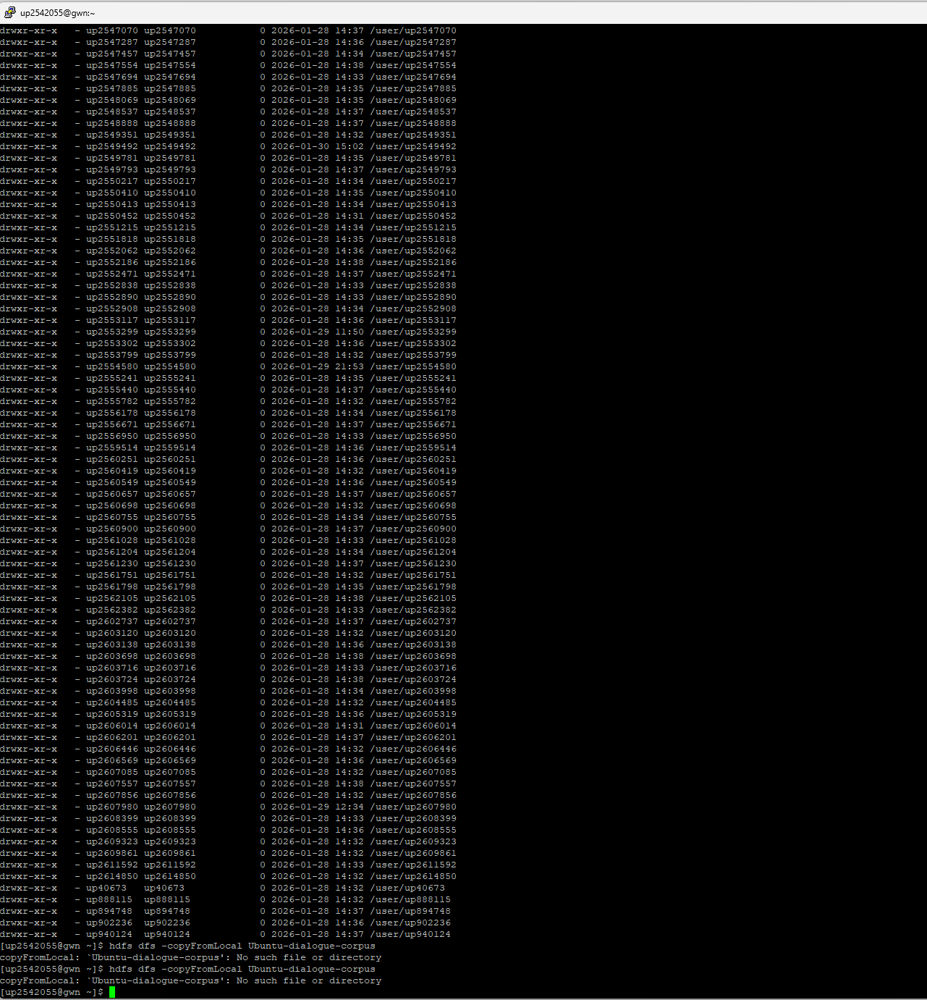
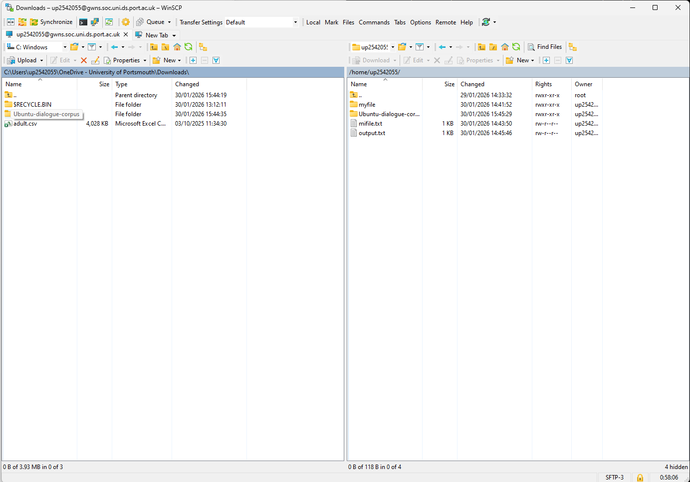
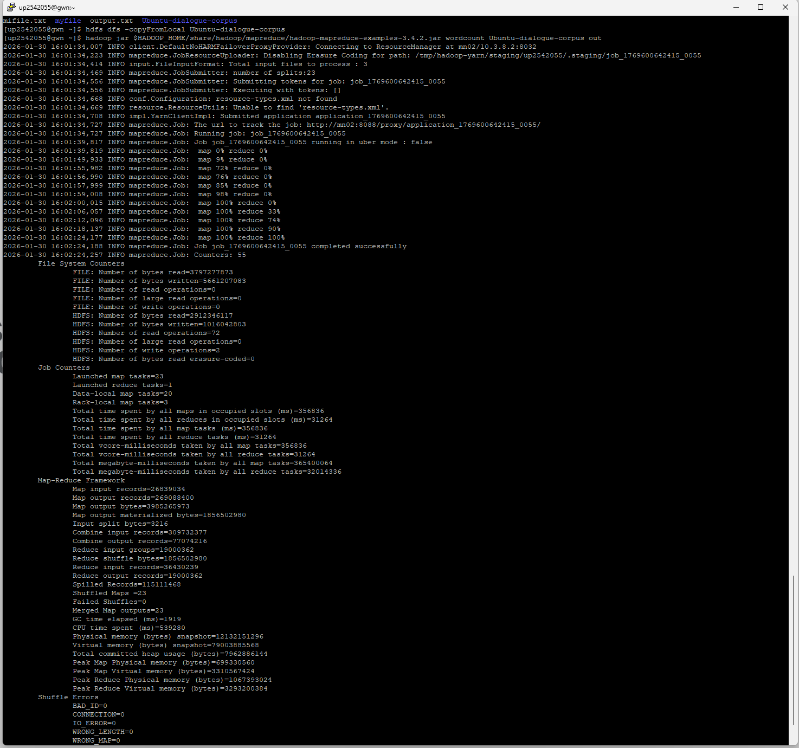
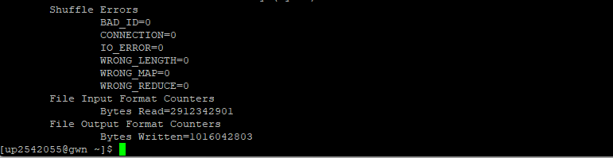
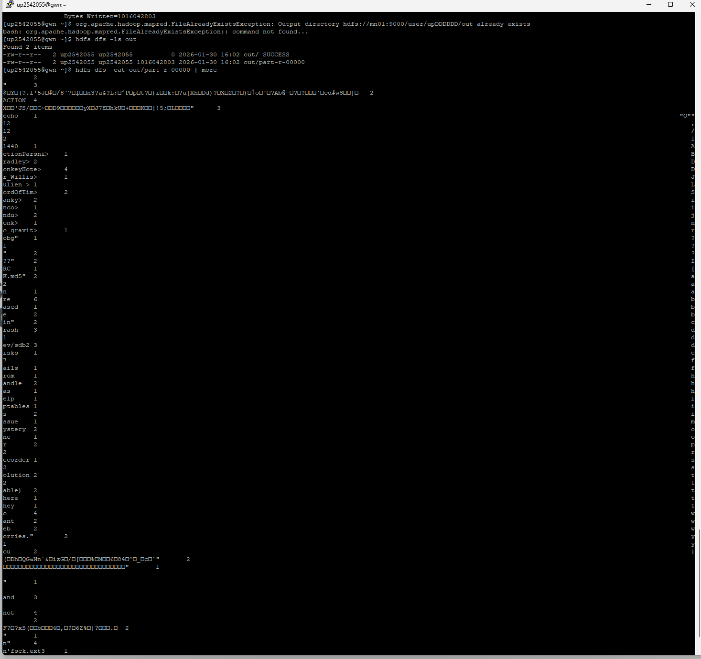
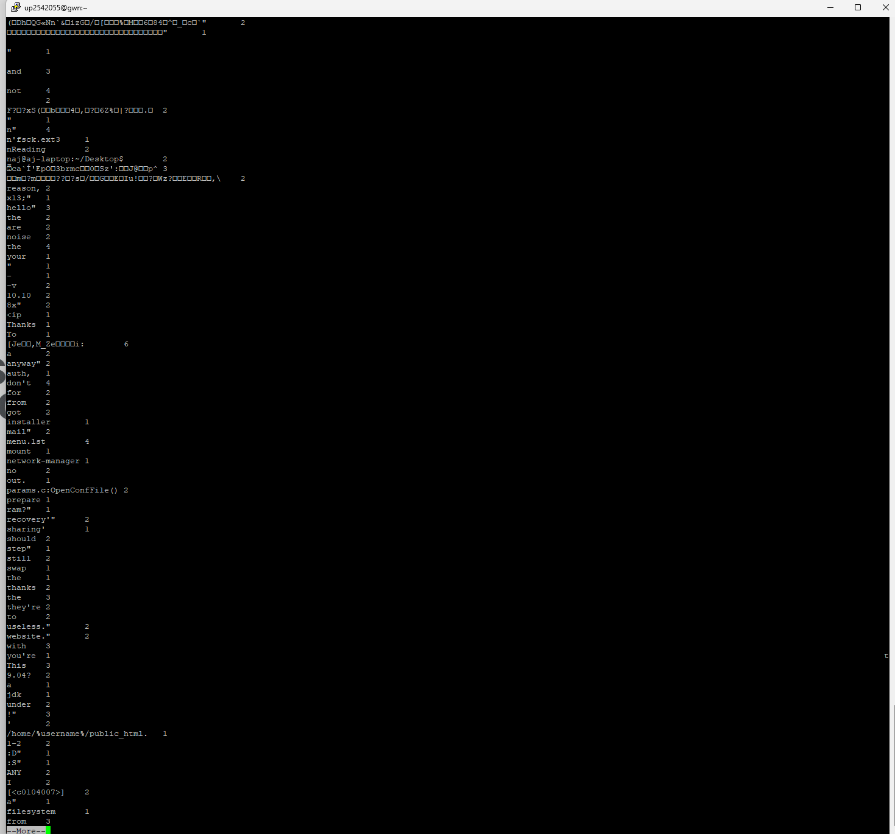
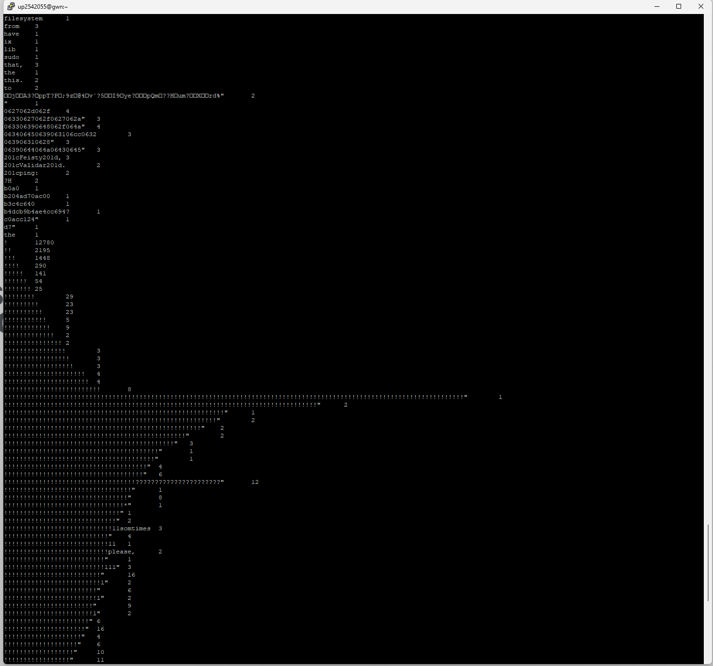
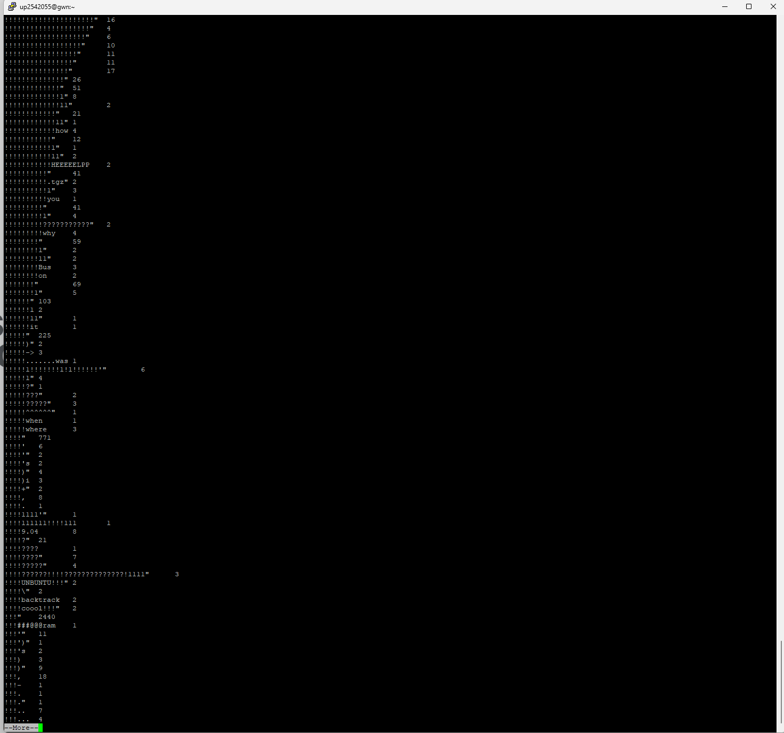

# Week 1 — Linux, HDFS and MapReduce

This lab explores Linux filesystem commands, HDFS user directories, and a Hadoop MapReduce WordCount job using the `Ubuntu-dialogue-corpus` dataset.

## Contents

- `scripts/linux-filesystem.sh` — Linux filesystem command walkthrough.
- `scripts/hdfs-wordcount.sh` — HDFS upload and Hadoop WordCount workflow.
- `screenshots/` — original screenshots extracted from the lab report.
- **Lab observations:** the sections below summarize the recorded results.

## 1. Linux filesystem

| Command | Purpose / recorded result |
|---|---|
| `ls` | Lists entries in the current directory. |
| `ls -l` | Displays detailed file metadata. |
| `mkdir myfile` | Creates a directory named `myfile`. |
| `nano myfile.txt` | Opens a terminal text editor to create or edit a file. |
| `cd ..` | Moves to the parent directory. |

The report explains the sample `afs` listing as a directory owned by `root`, with read/execute permissions for owner, group, and others.

## 2. HDFS and MapReduce WordCount

The report documents this workflow:

1. `hdfs dfs -ls /user` — list HDFS user directories.
2. `hdfs dfs -copyFromLocal Ubuntu-dialogue-corpus` — upload the local corpus to HDFS.
3. `hadoop jar $HADOOP_HOME/share/hadoop/mapreduce/hadoop-mapreduce-examples-3.4.2.jar wordcount Ubuntu-dialogue-corpus out` — run the Hadoop example WordCount job.
4. `hdfs dfs -ls out` — inspect output files.
5. `hdfs dfs -cat out/part-r-0000` — display reducer output.

The recorded job reached 100% map and reduce completion. The output directory contained `_SUCCESS` and `part-r-0000`.

### Sample word counts

| Word | Count |
|---|---:|
| `ctionParsni` | 1 |
| `radley` | 2 |
| `onkeyHote` | 4 |

The complete reducer output is shown in the screenshots; only these sample rows were explicitly transcribed in the report.

## 3. Screenshot index

### Linux filesystem

### HDFS users

### Dataset and MapReduce job

### WordCount output

## Reproducibility

These are results captured in the submitted lab report, not a new execution in this environment. The original corpus is not included. The scripts require a Linux shell and a configured Hadoop/HDFS environment.
